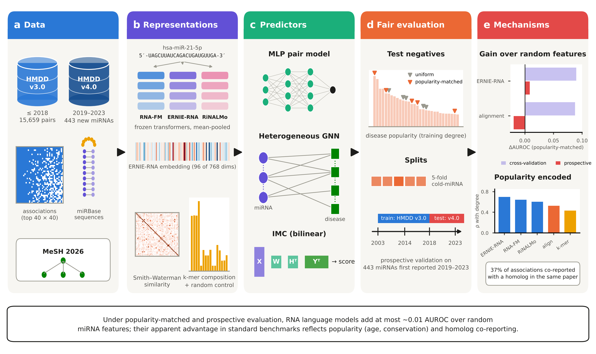

# Pretrained RNA Language Models Offer Limited Gains over Sequence Similarity in Cold-Start miRNA–Disease Prediction

Code, processed data and results for the paper

> **Do Pretrained RNA Language Models Go Beyond Sequence Similarity? A Popularity-Aware and Prospective Evaluation for Cold-Start miRNA–Disease Association Prediction**
> *Authors (to be added)*, 2026.

We compare frozen embeddings from three RNA language models (RNA-FM, ERNIE-RNA, RiNALMo-giga) with Smith–Waterman alignment, *k*-mer, random-feature and popularity-only baselines for **cold-start** miRNA–disease association prediction on HMDD. Every representation is evaluated with the same three predictors (MLP, heterogeneous GNN, inductive matrix completion) under:

* standard cross-validation with **uniform** negatives,
* **popularity-matched** negatives and popularity-debiased training,
* a **temporal** split within HMDD v3.0, and
* a **prospective** validation: train on HMDD v3.0 (≤2018), test on 443 miRNAs first reported in HMDD v4.0 (2019–2023).



## Main findings

| | ERNIE-RNA | RNA-FM | RiNALMo | SW alignment | Random features | Popularity only |
|---|---|---|---|---|---|---|
| Cold-miRNA CV, uniform negatives | **0.914** | 0.907 | 0.901 | 0.889 | 0.790 | 0.856 |
| Cold-miRNA CV, popularity-matched (debiased) | 0.675 | 0.670 | 0.664 | 0.673 | 0.585 | 0.672 |
| Prospective, new miRNAs, popularity-matched (debiased) | 0.580 | 0.564 | 0.568 | 0.552 | 0.572 | 0.612 |

AUROC, MLP model. Full results are in `results/` and in the paper.

## Repository layout

```
src/                 all code (see table below)
notebooks/
  01_extract_rna_lm_embeddings.ipynb   RNA-FM / ERNIE-RNA / RiNALMo embeddings (Colab, GPU)
  02_full_experiment_colab.ipynb       every experiment + analysis, step by step (Colab, CPU)
scripts/
  build_data.sh      rebuild data/processed* from raw files (optional)
  run_all.sh         run every experiment, analysis, table and figure (~6–7 h, 2 CPU cores)
data/
  processed/         HMDD v3.0: 903 miRNAs x 834 diseases, features (derived, label-free except assoc.npy)
  processed_v34/     HMDD v3.0 + v4.0 merged universe (1,350 miRNAs) for the prospective test
  README.md          where to download the raw files
results/             raw per-fold / per-seed results (CSV) and all summaries used in the paper
figures/             paper figures (PDF + PNG)
```

| Script | Purpose |
|---|---|
| `build_dataset.py`, `build_kmer.py`, `build_lm_features.py`, `build_align_sim.py` | association matrix, MeSH similarity, LM / k-mer / alignment features |
| `build_temporal.py`, `build_v34_raw.py` | first-evidence PMIDs; HMDD v3.0 + v4.0 merge |
| `build_confounders.py` | miRBase covariates (discovery order, conservation, length) |
| `experiment.py` | cross-validation (random / cold-miRNA / cold-disease), MLP / GNN / IMC, uniform vs popularity-matched negatives |
| `temporal.py` | temporal and prospective validation |
| `sanity_baselines.py` | popularity-only baseline |
| `analyze.py`, `analyze_temporal.py` | summaries, Wilcoxon tests, homology strata |
| `extra_analysis.py`, `confounder_analysis.py`, `covariate_probe.py`, `coreport.py` | mechanistic analyses |
| `make_tables.py`, `make_figures.py`, `make_workflow.py` | LaTeX tables and figures |
| `compare_all.py` | compare a re-run with the published results |

## Quick start

```bash
git clone https://github.com/<user>/mirna-lm-coldstart.git
cd mirna-lm-coldstart
pip install -r requirements.txt
# rebuild every table and figure from the stored results (minutes)
python src/analyze.py && python src/analyze_temporal.py && python src/make_tables.py && python src/make_figures.py
# re-run all experiments (hours); raw files needed only for the co-reporting/confounder analyses
bash scripts/run_all.sh
```

Or open `notebooks/02_full_experiment_colab.ipynb` in Google Colab.

Re-runs on different hardware or library versions typically differ by up to ~0.01 AUROC per run; rankings and conclusions are unchanged.

## Robustness analyses

| Script | What it does |
|---|---|
| `src/build_families.py` | miRNA name families, seed families (nt 2–8) and homology clusters (alignment ≥ 0.7) |
| `src/robust.py` | cold-miRNA CV with exact degree-preserving negatives; `--split group` holds out whole families |
| `src/analyze_robust.py`, `src/make_tables_robust.py`, `src/make_fig_novelty.py` | summary, Table 2, Supplementary Tables S4–S6, Figure 3 |
| `src/bootstrap_ci.py` | miRNA-level paired bootstrap CIs, Holm correction, ±0.01 equivalence test |
| `src/prospective_robust.py` | prospective bootstrap, alias exclusion, novelty strata |
| `src/false_negatives.py`, `src/prospective_checks.py`, `src/novelty_compare.py` | later-confirmed negatives, sequence aliases, relatedness of test miRNAs |

All of these steps are in Part 9 of `notebooks/02_full_experiment_colab.ipynb`.

## Data sources and licences

Raw data are **not** redistributed here; see `data/README.md`. HMDD (http://www.cuilab.cn/hmdd), miRBase (https://www.mirbase.org), MeSH (https://www.nlm.nih.gov/mesh) and the RNA language models (https://huggingface.co/multimolecule) are subject to their own terms. The processed files in `data/` are derived features provided for reproducibility.

## Citation

See `CITATION.cff`. Please also cite HMDD, miRBase, RNA-FM, ERNIE-RNA and RiNALMo.

## Licence

Code: MIT (see `LICENSE`).
